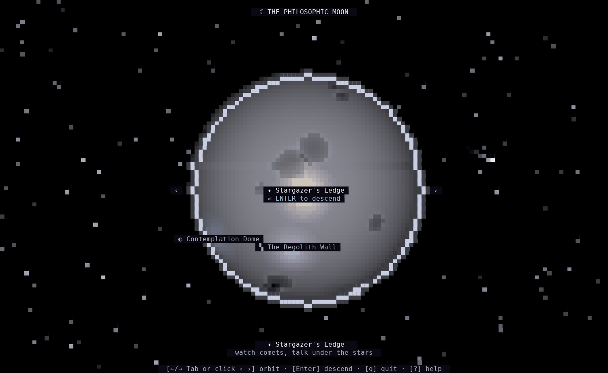
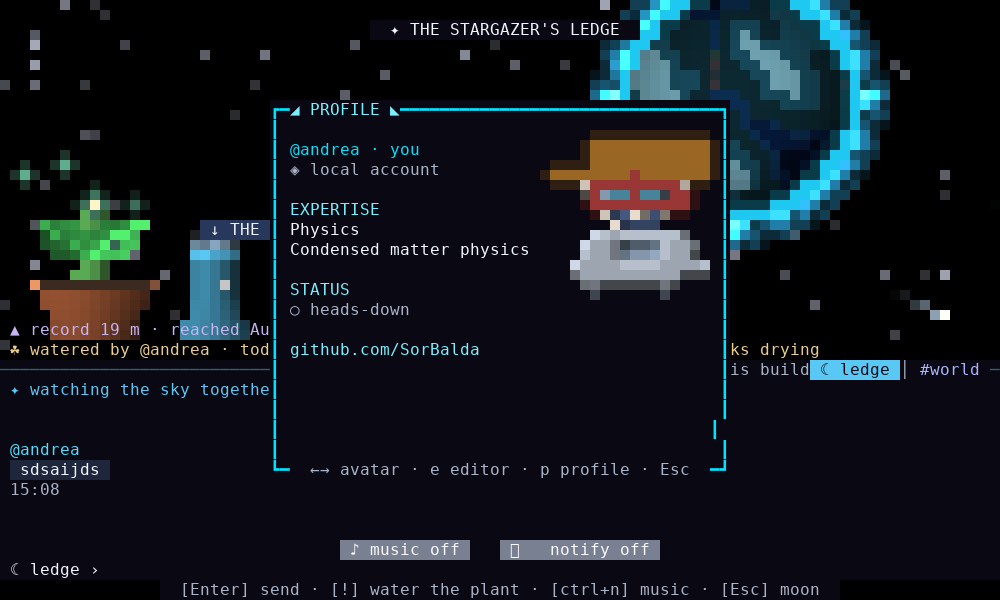

# ☾ philosophic moon

## Install

```sh
curl -fsSL https://raw.githubusercontent.com/SorBalda/philosophic-moon/main/install.sh | sh
moon
```



**Linux x86_64 · macOS Apple Silicon.** Installs to `~/.local/bin` and verifies
`SHA256SUMS`. If needed, follow the installer's instruction to update your `PATH`.

**Windows:** download and run [`moon-windows-amd64.exe`](https://github.com/SorBalda/philosophic-moon/releases/latest).

[All downloads](https://github.com/SorBalda/philosophic-moon/releases/latest).
New releases are offered as in-app updates.

## The moon

A shared moon in your terminal: chat, watch the sky, paint, and keep a plant alive.

- **Stargazer's Ledge:** chat under comets and auroras; water the communal plant.
- **Complaint Crater:** launch your complaints into orbit for everyone to read.
- **Contemplation Dome:** a quiet spot with music.
- **Regolith Wall:** a persistent graffiti wall you paint with your mouse.

Works offline too. Online, `#world` connects you to everyone across VibeWorld.

## Keys



| Key | Action |
| --- | --- |
| `←` / `→` | Orbit between places in the overview |
| `Enter` | Descend, or send a message while chatting |
| `Ctrl+P` | Open your profile; the profile button works too |
| `Tab` | Switch to `#world` while chatting online |
| `!` | Water the plant at the Ledge |
| `Ctrl+N` | Toggle music |
| `Esc` | Go back |
| `q` | Quit from the overview |

In your profile: `p` edits expertise and links, `←` / `→` browses avatars
(`Enter` saves), and `e` opens the pixel editor.

Part of **[VibeWorld](https://github.com/SorBalda/vibeworld)**:
same account, same live server, same moon. Profile changes carry across both apps.
